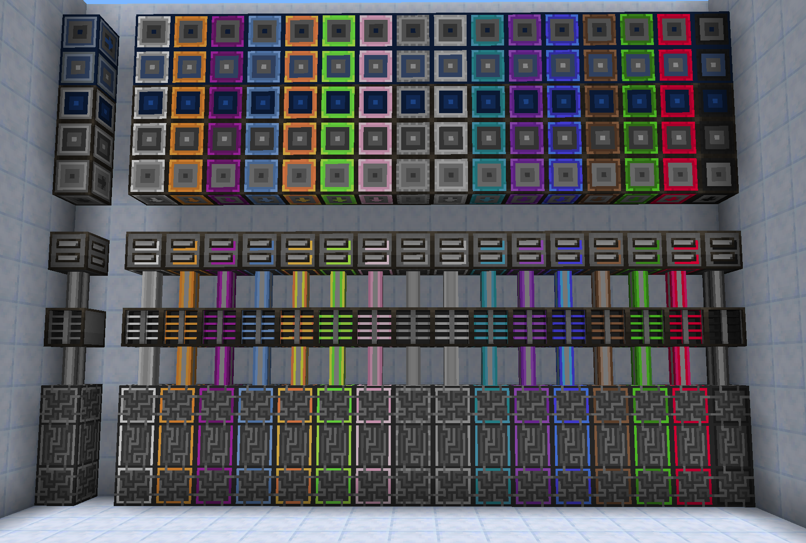
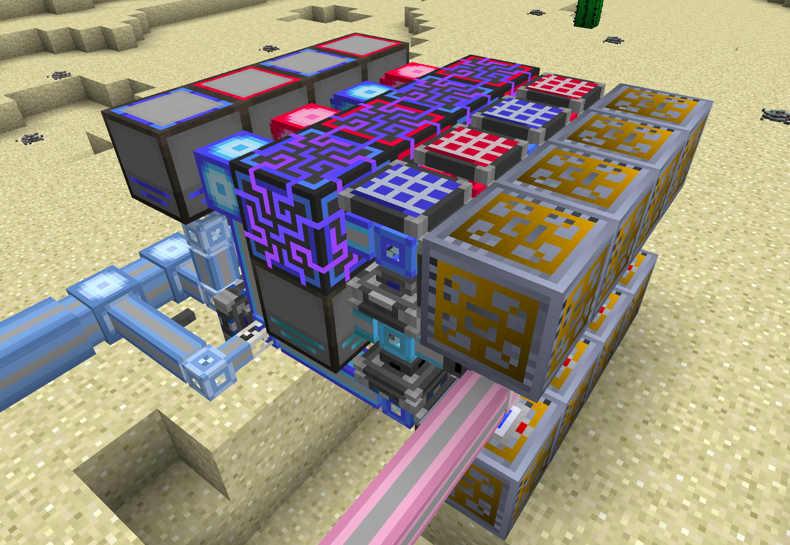

# AE2 More Painting

Adds the ability to paint more AE2 Components to [AE2UEL](https://github.com/AE2-UEL). This may be useful because components with different colors do not connect, even if they are next to eachother.

Components Currently Supported: controller, drive, interface, fluid interface, ae2fc dual interface, IO port.

Component showcase:

Use case:
 

## Strange issues with other mods

- Gregtech CEu causes the recolored drives to be invisible, Vintage Fix fixes this

## Dependencies

- [AE2 Unofficial Extended Life](https://github.com/AE2-UEL)- v0.56.7

### Optional Dependencies

- [AE2 Fluid Crafting Rework Unofficial](https://github.com/Circulate233/AE2FluidCraft-Rework-Unofficial)- v2.7.10

## Credits

The idea of colorable controllers, drives, and interfaces is not original, but is ported from [AE2-Unofficial GTNH fork](https://github.com/GTNewHorizons/Applied-Energistics-2-Unofficial/tree/master), which is under LGPL-3.0.

The textures are modified versions of the default [Applied Energistics 2](https://github.com/AppliedEnergistics/Applied-Energistics-2) textures, which is under LGPL-3.0.

## Development Notes

Parts of the code were written with the help of an AI assistant.